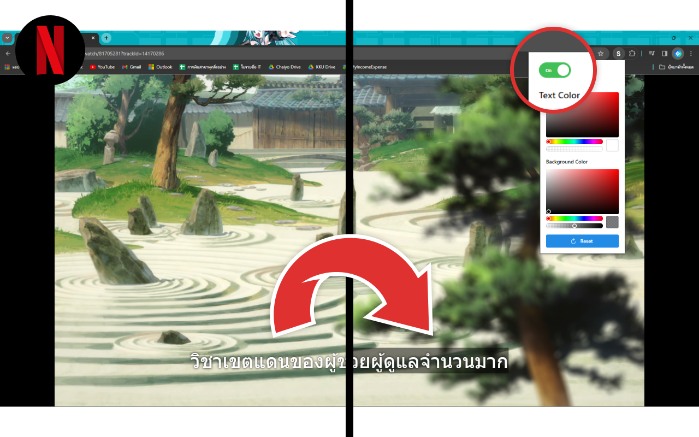
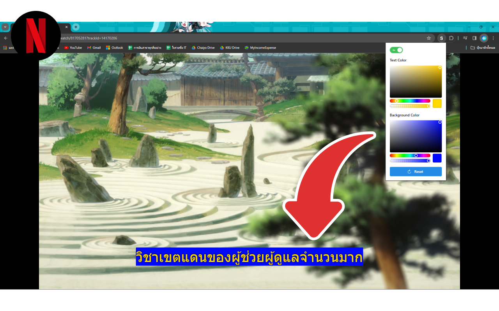

# SubStylist

Google chrome extension that **enhance your streaming experience on popular platforms by easily customize the appearance of subtitles to match your preferences and improve your viewing experience**

- Supported now: Netflix
- Coming soon: other streaming platforms

## Demo




## Getting Started

1. Install dependencies (Recommand `pnpm`)

   ```bash
   pnpm install
   ```

2. Running in development mode

   ```bash
   # Option 1 (Recommend)
   pnpm run build:watch

   # Option 2 (When develop popup ui only, go to http://localhost:5173/popup.html)
   pnpm run dev
   ```

## Production

1. Bump the version in `package.json` and `public/manifest.json` (keep both the same)
2. Commit and tag the new release

   ```bash
   git add package.json public/manifest.json
   git commit -m "chore: bump version vX.Y.Z"
   git tag vX.Y.Z
   git push origin vX.Y.Z
   ```

3. Build in production mode

   ```bash
   pnpm build
   ```
